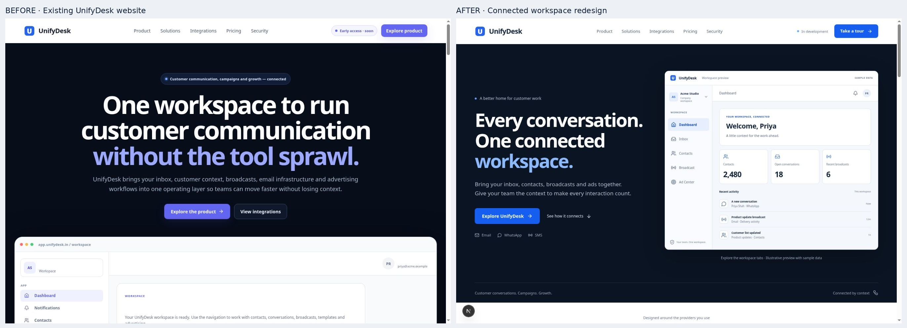
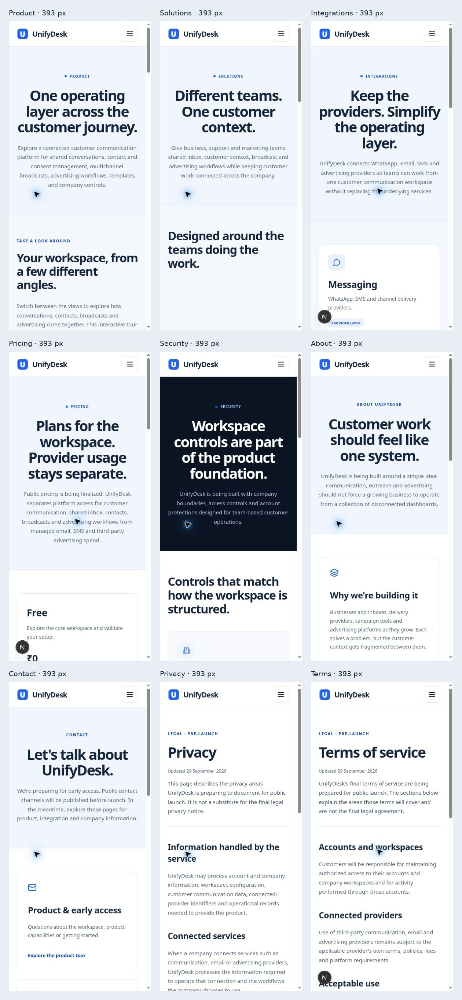

# Website redesign review

The website now uses a shared blue-and-white design system, a dark split hero, a working sample product tour, responsive navigation and consistent supporting pages.

See [design-qa.md](../../design-qa.md) for the comparison, responsive checks, interaction verification and remaining launch limitations.

## Development

Run `npm ci`, then `npm run dev`. The Next.js development wrapper also accepts managed preview flags `--host`, `--port` and `--strictPort`; regular Next.js arguments remain available.

Run `npm run typecheck` and `npm run build` to verify the static export. Stop a running development preview before a production build so they do not share `.next` artifacts concurrently.
